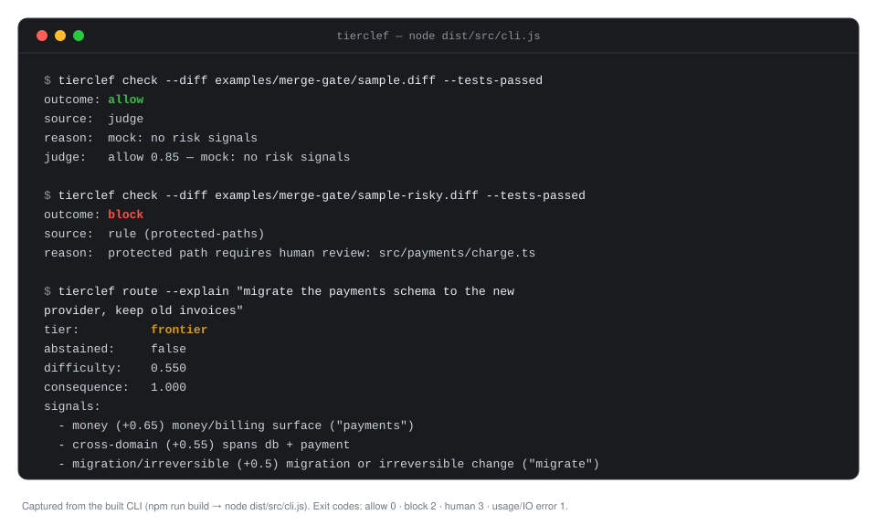

# Jev

**Jev — rules first, a cheap judge only when in doubt, humans for the irreversible. Measurable model routing and merge gates for coding agents.**

Jev is a small decision authority for coding agents: deterministic rules run
first (free, auditable), a cheap judge covers only the grey zone, and every
uncertain or irreversible action goes to a human. Use it as a TypeScript
library, a CLI merge gate / router, or an observe-only Claude Code plugin.

**Who it is for:** anyone wiring merge safety or model-tier routing into an
agent workflow who wants measurable exits (`allow` / `block` / `human`) instead
of free-text "LGTM".

[1. Quickstart](#1-quickstart-5-minutes) ·
[2. Use in your own project](#2-use-in-your-own-project) ·
[3. Config](#3-config) ·
[4. Claude Code plugin](#4-claude-code-plugin-observe-only) ·
[5. How it works](#5-how-it-works) ·
[6. FAQ](#6-faq--troubleshooting) ·
[7. Docs / contributing / roadmap](#7-docs-contributing-roadmap)

[](LICENSE)
[](#1-quickstart-5-minutes)
[](docs/PLAN.md)

---

## 1. Quickstart (5 minutes)

**Prerequisites:** Node `>=20` (`package.json` `engines.node`).

This package is **not published to npm as this project**. `package.json` has no
`"private": true`, but Harald’s `jev@0.2.0` is not on the registry — the bare
name `jev` on npm is an unrelated empty stub (`0.0.0` from 2021). Do **not**
`npm install jev`. Clone, build, and run the binary at `dist/src/cli.js`.

```bash
git clone https://github.com/HaraldSigvartsen/jev.git && cd jev
npm install
npm run build
npm test   # optional sanity — expect 180 tests passing
```

### Demo: merge gate

```bash
# Safe change (greeting copy + its test) — no rule hit, mock judge allows:
node dist/src/cli.js check --diff examples/merge-gate/sample.diff --tests-passed
```

```text
outcome: allow
source:  judge
reason:  mock: no risk signals
judge:   allow 0.85 — mock: no risk signals
```

Exit code `0` → allow.

```bash
# Touches protected path src/payments/charge.ts — first-hit rule stops before judge:
node dist/src/cli.js check --diff examples/merge-gate/sample-risky.diff --tests-passed
```

```text
outcome: block
source:  rule (protected-paths)
reason:  protected path requires human review: src/payments/charge.ts
```

Exit code `2` → block (stop for human review). The risky sample also contains a
fake secret literal; `protected-paths` wins because it is earlier in the pack.

### Demo: route

```bash
node dist/src/cli.js route --explain "Migrate the payments database in production"
```

```text
tier:          frontier
abstained:     false
difficulty:    0.550
consequence:   1.000
verifiability: 0.000
signals:
  - deploy/production (+0.7) deployment or production surface ("production")
  - money (+0.65) money/billing surface ("payments")
  - cross-domain (+0.55) spans db + payment
  - migration/irreversible (+0.5) migration or irreversible change ("migrate")
explanation:   score=0.73 (= 0.6·difficulty + 0.4·consequence) | axes: …
```



### Eval (optional)

```bash
npm run eval
npm run eval:independent
```

| Eval | Accuracy | What it measures |
| --- | --- | --- |
| Consistency (`npm run eval`) | **100%** (32/32) | Labels aligned with the same heuristics under test — intended-policy **consistency**, not external validity. |
| Independent (`npm run eval:independent`) | **72%** (18/25) | Prose scenarios labelled from [eval/independent/policy.md](eval/independent/policy.md) (M1–M5 / R1–R4) **before** running jev, including predicted adversarial misses. |

They differ on purpose: 100% consistency means the gate matches its own rule
pack; 72% independent means policy-labelled humans disagree on seven edge
cases (e.g. `.env.example` placeholders still trip `secrets-in-diff`). See the
policy doc and the generated (gitignored) reports under `eval/`.

### Exit codes

| Code | Meaning |
| --- | --- |
| `0` | allow |
| `2` | block |
| `3` | human decision required |
| `1` | usage / IO error (empty diff, bad flags, unreadable file, …) |

```bash
node dist/src/cli.js check --diff examples/merge-gate/sample.diff --tests-passed
echo $?    # 0

node dist/src/cli.js check --diff examples/merge-gate/sample-risky.diff --tests-passed
echo $?    # 2
```

Unspecified test status is treated as **not green** (only `--tests-passed`
claims green). Empty or non-diff input is exit `1`, never an implicit allow.

---

## 2. Use in your own project

### a) Library

After `npm run build` in a clone, import from the built package (path / git
dependency — not `npm install jev`). Real exports from `src/index.ts`:

```ts
import {
  defineGate,
  makeMergeRules,
  MockJudge,
  type Decision,
} from 'jev'; // or: from './dist/src/index.js' in a clone

const gate = defineGate({
  rules: makeMergeRules(),
  judge: new MockJudge(), // free, no network; swap for OpenAICompatibleJudge below
  threshold: 0.7,
  onUncertain: ({ reason }) => {
    console.error(`human needed: ${reason}`);
  },
});

const decision: Decision = await gate.decide({
  action: 'merge',
  diff: unifiedDiff, // treat as data, never instructions
  files: ['src/greet.ts'],
  irreversible: false,
  context: { testsPassed: true },
});

// decision.outcome: 'allow' | 'block' | 'human'
// decision.source:  'rule' | 'judge' | 'human' | 'none'
// decision.log:     structured audit trail
```

Real judge (key from env only; missing key → abstain → human):

```ts
import { defineGate, makeMergeRules, OpenAICompatibleJudge } from 'jev';

const gate = defineGate({
  rules: makeMergeRules(),
  judge: new OpenAICompatibleJudge({
    baseUrl: 'https://api.openai.com/v1',
    model: 'gpt-4o-mini',
    apiKeyEnv: 'JEV_JUDGE_API_KEY', // default if omitted
  }),
  threshold: 0.7,
});
```

Irreversible: even if the judge allows, the gate returns `human`:

```ts
const decision = await gate.decide({
  action: 'merge',
  diff: unifiedDiff,
  files: ['src/greet.ts'],
  irreversible: true, // judge allow → always human
  context: { testsPassed: true },
});
// outcome: human — "irreversible action: judge allow cannot approve without a human"
```

### b) CLI in a real workflow

```bash
git diff > /tmp/change.diff
node /path/to/jev/dist/src/cli.js check --diff /tmp/change.diff --tests-passed
echo $?
```

Pipe / stdin (supported — `--diff -` or omit `--diff`):

```bash
git diff | node /path/to/jev/dist/src/cli.js check --diff - --tests-passed
# same: git diff | node /path/to/jev/dist/src/cli.js check --tests-passed
```

**Example** GitHub Actions job (adapt paths / base branch; not a drop-in for
every repo). Exit `2` or `3` fails the job (= needs human review). No jev
secrets required for the default `MockJudge` CLI:

```yaml
# .github/workflows/jev-check.yml — EXAMPLE to adapt
name: jev merge gate
on:
  pull_request:
jobs:
  jev-check:
    runs-on: ubuntu-latest
    steps:
      - uses: actions/checkout@v4
        with:
          fetch-depth: 0
      - uses: actions/setup-node@v4
        with:
          node-version: '20'
      - name: Build jev (from clone / submodule / path)
        run: |
          git clone --depth 1 https://github.com/HaraldSigvartsen/jev.git /tmp/jev
          cd /tmp/jev && npm ci && npm run build
      - name: Diff vs base and run gate
        run: |
          git diff origin/${{ github.base_ref }}...HEAD > /tmp/change.diff
          node /tmp/jev/dist/src/cli.js check --diff /tmp/change.diff --tests-passed
          # exit 0 allow · 2 block · 3 human · 1 usage error
```

If you later wire `OpenAICompatibleJudge` into a custom gate in CI, put the
key in Actions secrets (`JEV_JUDGE_API_KEY`) — never commit it. The stock CLI
uses `MockJudge` only.

### c) Write your own rule

Shape from `src/gate.ts`: `id` + `evaluate` returning a `RuleHit` or `null`.
**First hit wins** — put stricter / cheaper checks first.

```ts
import { defineGate, makeMergeRules, MockJudge, type Rule } from 'jev';

const blockLockfiles: Rule = {
  id: 'block-lockfiles',
  evaluate(input) {
    const files = input.files ?? [];
    const hit = files.find((f) => f.endsWith('.lock') || f.endsWith('-lock.json'));
    if (!hit) return null;
    if (input.context?.allowLockChange === true) return null;
    return {
      outcome: 'block',
      reason: `lockfile change requires context.allowLockChange: ${hit}`,
    };
  },
};

// Custom rule first → it can stop the merge before makeMergeRules runs.
const gate = defineGate({
  rules: [blockLockfiles, ...makeMergeRules()],
  judge: new MockJudge(),
});
```

---

## 3. Config

There is **no auto-loaded config file**. The CLI does not read `jev.config.ts`;
`jev plugin --config <json>` explicitly reads a plugin-only JSON config.
The typed example is for you to copy fields into `defineGate` /
`makeMergeRules({ protectedGlobs })` / your own wiring. See
[examples/config/README.md](examples/config/README.md) and
[examples/config/jev.config.example.ts](examples/config/jev.config.example.ts).

| Field | Purpose | Honesty (v0.2) |
| --- | --- | --- |
| `protectedPaths` | Globs for paths that always stop for human review (`makeMergeRules({ protectedGlobs })`). | Wired when you pass them into `makeMergeRules`. |
| `modelLadder` | `tier` / `model` / placeholder `inputPer1M` / `outputPer1M` per `cheap` \| `mid` \| `frontier`. | Illustrative prices; `scoreRoute` only returns a tier — you map model yourself. |
| `plugin.subagentModels` | Claude Code aliases per route tier. | Pass `config.plugin` into the plugin generator API, or its contents as `plugin --config <json>`; baked into generated agent files. |
| `irreversibleActions` | Example phrases (`deploy production`, `run migration`, `delete *`). | **Informational** — the engine does **not** match this list yet. The gate keys off `input.irreversible` (CLI: `--irreversible`). |
| `skillsByTaskType` | Planned mapping of task type → skill/policy docs. | **Informational** — the gate ignores it today. |
| `judge.threshold` | Minimum judge score to act on allow/block (default `0.7`). | Pass into `defineGate({ threshold })`. |

---

## 4. Claude Code plugin (observe-only)

### Generate

```bash
npm run build
node dist/src/cli.js plugin --out ./my-jev-plugin
```

`--out` prints **resolved absolute paths** (one per generated file).

Tree (relative to the out dir):

```text
my-jev-plugin/
  .claude-plugin/plugin.json
  hooks/hooks.json
  scripts/jev-observe.mjs
  agents/jev-cheap.md
  agents/jev-mid.md
  agents/jev-frontier.md
  config.json
  README.md
```

Optional protected globs (embedded in `config.json` for the plugin; observe-only
today — informational until blocking hooks land):

```bash
node dist/src/cli.js plugin --out ./my-jev-plugin --protected '**/payments/**' --protected '*.lock'
```

The agents use Claude Code model aliases, configurable through
`JevPluginConfig.subagentModels` or an explicit plugin JSON file:

```json
{
  "subagentModels": { "cheap": "haiku", "mid": "sonnet", "frontier": "inherit" }
}
```

Save as `jev-plugin.json`, then generate with:

```bash
node dist/src/cli.js plugin --out ./my-jev-plugin --config ./jev-plugin.json
```

Omitted tiers use the defaults shown. Allowed values are `haiku`, `sonnet`,
`opus`, and `inherit`; invalid aliases are rejected before files are written.
`inherit` uses the main session's model for the subagent, so the frontier tier
does not guarantee frontier capability or a lower cost. Choose `opus` explicitly
if wanted. The JSON also accepts `protectedPaths` and `logFileName`;
`--protected` replaces configured globs. Regenerate after config changes:
editing the emitted `config.json` does not change agent frontmatter.
See [Claude Code's subagent docs](https://code.claude.com/docs/en/sub-agents)
for the host format and model selection behavior.

### Load / validate

What is verified today:

```bash
claude --plugin-dir ./my-jev-plugin          # per session
claude plugin validate ./my-jev-plugin       # ✔ Validation passed
```

(`claude plugin validate` may print **advice** about adding a marketplace
install line — that does not fail validation.)

**Marketplace install is not available yet** — there is no `marketplace.json`
in this repo; that is a later roadmap step. Do not document `/plugin install`
as working for jev today. Persistent install via copy/symlink into a Claude
Code plugins directory may work depending on your Claude Code build; the
commands we treat as certain are `--plugin-dir` (session) and `plugin validate`.

A checked-in dogfood copy lives under [`plugin/`](plugin/).

### What it does / does not do

On `UserPromptSubmit` it scores the prompt with miniature route signals,
prints `additionalContext` with the tier and suggested subagent, and appends **one JSON line** to
`~/.jev/observe.jsonl` (or `JEV_OBSERVE_LOG`):

```json
{"ts":"2026-10-19T14:22:41.407Z","session_id":"demo-session","cwd":"/tmp","tier":"mid","signals":["ambiguous"],"promptChars":20}
```

Fields: `ts`, `session_id`, `cwd`, `tier`, `signals`, `promptChars` only —
**never the prompt text**. It never blocks and never swaps the host model.

For example, a frontier annotation suggests `jev:jev-frontier` (the plugin-scoped
name of `jev-frontier`). This is **advisory
delegation only**: the hook never spawns an agent, and the host decides whether
to delegate when subagents are available. Agent files carry YAML frontmatter
(`name`, `description`, `model`) and instructions to follow host permissions
and return uncertain or irreversible actions for human review. The observe
hook still uses its existing miniature scorer, not the full `scoreRoute` API.

```bash
tail -f ~/.jev/observe.jsonl
```

### Turn off

Stop passing `--plugin-dir`, delete the generated plugin directory, and
optionally `rm -rf ~/.jev` if you no longer want local observe logs.

---

## 5. How it works


1. **Rules (deterministic, free).** Ordered checks; first hit decides; judge
   skipped. Shipped pack (`makeMergeRules()`): tests-not-green →
   protected-paths → secrets-in-diff → new-dependencies → diff-too-large.
   Diff text is data — injection cannot change rule outcomes.
2. **Cheap judge (grey zone only).** Strict verdict enum
   (`allow` / `block` / `abstain`) + finite score in `[0,1]` + non-empty
   evidence. Malformed / below threshold / `abstain` → **human**.
3. **Human.** Everything uncertain. `irreversible: true` + judge `allow` →
   always human; judge `block` still blocks (safe direction).

Every decision appends a structured log (`stage` / `detail`).

**Security:** injection treated as data; fail closed to human; secrets in
tests/examples are fakes (`FAKE_EXAMPLE_ONLY_*`); judge key via env only
(`JEV_JUDGE_API_KEY`).

**Honesty / limits:**

- A plugin cannot swap the host’s main model mid-session.
- Routing is advisory (`scoreRoute` → dispatch/subagents), not a gateway in
  the traffic path.
- Strict judge format ≠ correctness; `ABSTAIN` exists so uncertainty costs a
  human, not a wrong allow.

**What this is not:**

- Not [Promptfoo](https://github.com/promptfoo/promptfoo) / [Evalite](https://evalite.dev) (those evaluate prompts/models).
- Not [claude-code-router](https://github.com/musistudio/claude-code-router) / [LiteLLM](https://github.com/BerriAI/litellm) / [OpenRouter](https://openrouter.ai) (those proxy/route model traffic).
- Not a code-reviewer replacement — the judge makes one narrow measurable
  decision: allow, block, or abstain.

---

## 6. FAQ / troubleshooting

**Why was I blocked?** Read `outcome`, `source`, `ruleId`, `reason`. Use
`--json` for machine-readable output:

```bash
node dist/src/cli.js check --diff examples/merge-gate/sample-risky.diff --tests-passed --json
```

```json
{
  "outcome": "block",
  "source": "rule",
  "ruleId": "protected-paths",
  "reason": "protected path requires human review: src/payments/charge.ts"
}
```

**False block on `.env` placeholders?** Known independent-eval miss:
`YOUR_API_KEY_HERE`-style placeholders in `.env.example` can still trip
`secrets-in-diff` (expected `allow`, actual `block`). Listed under independent
misses; see [eval/independent/policy.md](eval/independent/policy.md).

**Judge / no API key?** CLI and eval default to `MockJudge` (free, offline).
`OpenAICompatibleJudge` with a missing `JEV_JUDGE_API_KEY` abstains → gate
returns `human` (never throws into allow).

**Disable the gate for one change?** Don’t run `jev check`, or temporarily
adjust/remove rules in the code that builds your gate. Plugin: stop loading
it (`--plugin-dir` off) / delete the plugin dir.

**Does it phone home?** No. Library/CLI with `MockJudge` make no network
calls. Network only happens if **you** configure `OpenAICompatibleJudge` to
your endpoint. The observe plugin writes locally only.

**Which hosts today?** Library + CLI anywhere Node runs. Plugin: Claude Code
only. Codex / Cursor / OpenCode adapters are roadmap (v0.3).

**Empty diff → exit 1?** By design — refusing to run on no input (never fail
open).

**Forgot `--tests-passed`?** Treated as not green → `tests-not-green` blocks
(exit `2`).

---

## 7. Docs, contributing, roadmap

| Doc | What |
| --- | --- |
| [docs/FIELDTEST.md](docs/FIELDTEST.md) | Field-test notes |
| [docs/REVIEW.md](docs/REVIEW.md) | Review findings |
| [docs/PLAN.md](docs/PLAN.md) | Plan + phase checklists |
| [eval/independent/policy.md](eval/independent/policy.md) | Independent eval labelling policy |
| [examples/merge-gate/](examples/merge-gate/) | Demo diffs |
| [examples/config/](examples/config/) | Typed config example |

### Contributing

```bash
npm test                 # vitest (180 tests)
npm run typecheck        # tsc --noEmit
npm run build            # tsc → dist/
npm run eval             # consistency eval (heuristic-aligned labels)
npm run eval:independent # policy-labelled independent eval
```

### Roadmap (short)

- **v0.2 (this):** observe-only Claude Code plugin and advisory tier subagents done. Still ahead in v0.2:
  blocking/merge hooks, MCP `decide` / `route` / `explain`, cost report,
  marketplace packaging.
- **v0.3 — EverythingJevCan:** multi-host adapters; weekly config-proposal PRs
  from the decision log (human approves; never auto-merge).

License: [MIT](LICENSE) © 2026 Harald Sigvartsen.
