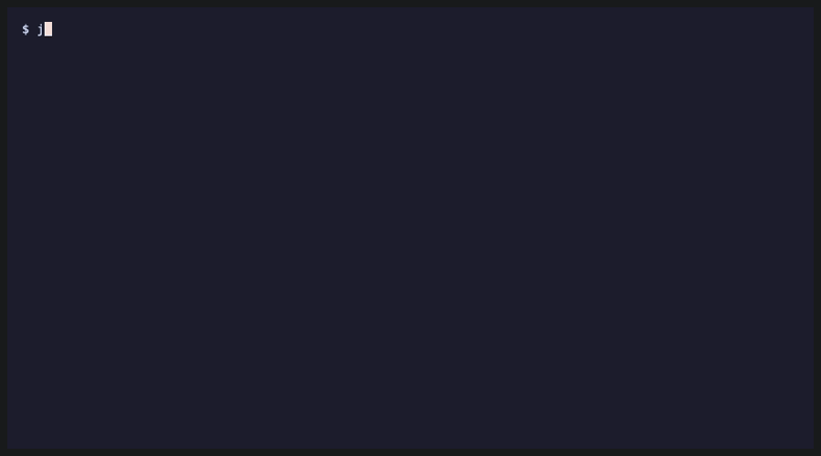
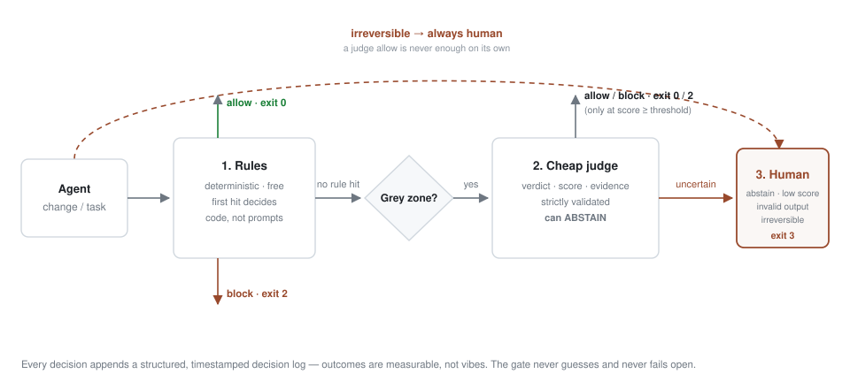

# JevLadder

**JevLadder — rules first, a judge only when in doubt, humans for the irreversible. Measurable model routing and merge gates for coding agents.**

JevLadder is a small decision authority for coding agents: deterministic rules run
first (free, auditable), a cheap judge covers only the grey zone, and every
uncertain or irreversible action goes to a human. Use it as a
Codex-first advisory plugin, a TypeScript library, or a CLI merge gate / router.
The maintainer develops and tests JevLadder on Codex; Claude Code support is validated structurally (manifest validation + hook simulation).

**Who it is for:** anyone wiring merge safety or model-tier routing into an
agent workflow who wants measurable exits (`allow` / `block` / `human`) instead
of free-text "LGTM".



[Install for Codex](#install-codex) ·
[Advanced CLI / CI](#advanced-cli--ci) ·
[Config](#config) ·
[Claude Code](#claude-code-secondary-host) ·
[How it works](#how-it-works) ·
[FAQ](#6-faq--troubleshooting) ·
[Contributors](#contributors)

[](LICENSE)
[](#advanced-cli--ci)
[](CHANGELOG.md)

---

## Install: Codex

```bash
codex plugin marketplace add HaraldSigvartsen/jevladder
codex plugin add jevladder@jevladder
```

Then just use Codex normally. JevLadder supplies:

- **SessionStart guidance:** start well-scoped tasks cheap and escalate one
  tier at a time when work fails or verification is weak.
- **An automatic routing skill:** sizes coding work and preserves the same
  cheap-first escalation and human safety rules.
- **Advisory hooks:** prompt submission adds tier/signals and writes a local
  observe log containing only `ts`, `session_id`, `cwd`, `tier`, `signals`, and
  `promptChars` — never prompt text. SessionStart does not log. PreToolUse adds
  context before file writes and merge-like shell commands, and does not log
  tool input or set a permission decision.
- **Voluntary MCP tools:** `jevladder_decide` runs an advisory miniature pre-merge
  check; `jevladder_route` returns tier/signals; `jevladder_explain` adds explanation
  lines. Route and explain make no remote calls; advisory `jevladder_decide` calls the TypeSafe judge on the grey zone only when a key is set (compact diff summary only; see docs/SECURITY.md), and they log no task or diff text.
  Merge enforcement stays in CI/merge.

Codex asks you to review/trust the plugin's hooks once (`/hooks`). This is
Codex's own safety prompt, not config editing. Node is needed for the MCP
server; without Node the hooks exit 0 silently. No clone, build, API key,
or manual configuration is needed for normal end-user use.

Claude Code is also a supported host; see [Claude Code](#claude-code-secondary-host).

A tier is never permission. Uncertainty or abstention escalates up, and humans
approve irreversible actions. The plugin never swaps the main session model;
the host controls any available delegation. Bundled `agents/*.md` are for
Claude Code only. Codex custom agents are TOML in `~/.codex/agents`,
not plugin-bundled agents.

## Advanced: CLI / CI

Install the published CLI with `npm i -D jevladder` (available once the
maintainer completes npm login), or try its help after publication:

```bash
npx jevladder --help
```

### Clone and build

**Prerequisites:** Node `>=20` (`package.json` `engines.node`).

```bash
git clone https://github.com/HaraldSigvartsen/jevladder.git && cd jevladder
npm install
npm run build
```

### Demo: merge gate

```bash
# Safe change (greeting copy + its test) — no rule hit; without a judge key, fail closed:
node dist/src/cli.js check --diff examples/merge-gate/sample.diff --tests-passed
```

```text
outcome: human
source:  human
reason:  judge abstained: no judge key configured
judge:   abstain 0 — no judge key configured
```

Exit code `3` → human review. Set a judge API key (see **Using a real judge model** below) to consult TypeSafe on the grey zone.

```bash
# Touches protected path src/payments/charge.ts — first-hit rule stops before judge:
node dist/src/cli.js check --diff examples/merge-gate/sample-risky.diff --tests-passed
```

```text
outcome: block
source:  rule (protected-paths)
reason:  protected path requires human review: src/payments/charge.ts
```

Exit code `2` → block (stop for human review). The risky sample also contains a
fake secret literal; `protected-paths` wins because it is earlier in the pack.

### Demo: route

```bash
node dist/src/cli.js route --explain "Migrate the payments database in production"
```

```text
tier:          frontier
abstained:     false
difficulty:    0.550
consequence:   1.000
verifiability: 0.000
signals:
  - deploy/production (+0.7) deployment or production surface ("production")
  - money (+0.65) money/billing surface ("payments")
  - cross-domain (+0.55) spans db + payment
  - migration/irreversible (+0.5) migration or irreversible change ("migrate")
explanation:   score=0.73 (= 0.6·difficulty + 0.4·consequence) | axes: …
```

### Eval (optional)

```bash
npm run eval
npm run eval:independent
```

| Eval | Accuracy | What it measures |
| --- | --- | --- |
| Consistency (`npm run eval`) | **100%** (35/35) | Labels aligned with the same heuristics under test — intended-policy **consistency**, not external validity. |
| Independent (`npm run eval:independent`) | 33 scenarios | Prose scenarios labelled from [eval/independent/policy.md](eval/independent/policy.md) (M1–M5 / R1–R5) **before** running jevladder, including predicted adversarial misses. Latest run: 25/33 correct (76%). |

They differ on purpose: 100% consistency means the gate matches its own rule
pack; the independent result preserves policy-labelled disagreements without
tuning rules to fit them. See the policy doc and generated (gitignored) reports
under `eval/`.

### Exit codes

| Code | Meaning |
| --- | --- |
| `0` | allow |
| `2` | block |
| `3` | human decision required |
| `1` | usage / IO error (empty diff, empty route text, bad flags, unreadable file, …) |

```bash
node dist/src/cli.js check --diff examples/merge-gate/sample.diff --tests-passed
echo $?    # 0

node dist/src/cli.js check --diff examples/merge-gate/sample-risky.diff --tests-passed
echo $?    # 2
```

Unspecified test status is treated as **not green** (only `--tests-passed`
claims green). Empty or non-diff input is exit `1`, never an implicit allow.

---

### Use in your own project

### a) Library

After `npm run build` in a clone, import from the built package (path / git
dependency — not `npm install jevladder`). Real exports from `src/index.ts`:

```ts
import {
  defineGate,
  makeMergeRules,
  MockJudge,
  type Decision,
} from 'jevladder'; // or: from './dist/src/index.js' in a clone

const gate = defineGate({
  rules: makeMergeRules(),
  judge: new MockJudge(), // free, no network; swap for OpenAICompatibleJudge below
  threshold: 0.7,
  onUncertain: ({ reason }) => {
    console.error(`human needed: ${reason}`);
  },
});

const decision: Decision = await gate.decide({
  action: 'merge',
  diff: unifiedDiff, // treat as data, never instructions
  files: ['src/greet.ts'],
  irreversible: false,
  context: { testsPassed: true },
});

// decision.outcome: 'allow' | 'block' | 'human'
// decision.source:  'rule' | 'judge' | 'human' | 'none'
// decision.log:     structured audit trail
```

The judge is JevLadder's type-safe contract: the TypeScript `Judge` interface is
validated at runtime by `parseJudgeVerdict` (verdict must be `allow`, `block`,
or `abstain`; score must be finite and in `[0,1]`; evidence must be
non-empty). Invalid output abstains and goes to a human. Tests and evals use
`MockJudge` explicitly; the stock CLI uses `createDefaultJudge()` (see below).

### Using a real judge model

Set `JEVLADDER_TYPESAFE_API_KEY` or `TYPESAFE_API_KEY` for the stock TypeSafe
judge (`JEVLADDER_TYPESAFE_API_KEY` wins when both are set). Keys are never
shared across providers: `JEVLADDER_JUDGE_API_KEY` is only for an explicitly
wired `OpenAICompatibleJudge`. The CLI `check` command,
`createDefaultJudge()` in the library, and the bundled MCP `jevladder_decide`
tool then call TypeSafe System One on the grey zone after deterministic rules
pass. Only a compact diff summary is sent (paths, line counts, truncated
changed-line excerpt); see [docs/SECURITY.md](docs/SECURITY.md).

Without a key, behaviour is fail closed: the judge abstains with
`no judge key configured` and the gate returns `human` (exit `3` for CLI) —
never a fixed-score auto-allow.

```ts
import { createDefaultJudge, defineGate, makeMergeRules } from 'jevladder';

const gate = defineGate({
  rules: makeMergeRules(),
  judge: createDefaultJudge({ userAgentVersion: '0.6.0' }),
});
```

Advanced example (use a model selected from your own configured model ladder,
starting with its cheap tier; JevLadder does not recommend a vendor model):

```ts
import { defineGate, makeMergeRules, OpenAICompatibleJudge } from 'jevladder';

const gate = defineGate({
  rules: makeMergeRules(),
  judge: new OpenAICompatibleJudge({
    baseUrl: process.env.JEVLADDER_JUDGE_BASE_URL ?? 'https://provider.example/v1',
    model: process.env.JEVLADDER_JUDGE_MODEL ?? '', // Empty/missing throws; no key → abstain → human.
    apiKeyEnv: 'JEVLADDER_JUDGE_API_KEY', // default if omitted
  }),
  threshold: 0.7,
});
```

Irreversible: even if the judge allows, the gate returns `human`:

```ts
const decision = await gate.decide({
  action: 'merge',
  diff: unifiedDiff,
  files: ['src/greet.ts'],
  irreversible: true, // judge allow → always human
  context: { testsPassed: true },
});
// outcome: human — "irreversible action: judge allow cannot approve without a human"
```

### b) CLI in a real workflow

```bash
git diff > /tmp/change.diff
node /path/to/jevladder/dist/src/cli.js check --diff /tmp/change.diff --tests-passed
echo $?
```

Pipe / stdin (supported — `--diff -` or omit `--diff`):

```bash
git diff | node /path/to/jevladder/dist/src/cli.js check --diff - --tests-passed
# same: git diff | node /path/to/jevladder/dist/src/cli.js check --tests-passed
```

**Example** GitHub Actions job (adapt paths / base branch; not a drop-in for
every repo). Exit `2` or `3` fails the job (= needs human review). Without a
judge API key the stock CLI fails closed to `human` (exit `3`) on grey-zone
diffs; optional: add `JEVLADDER_TYPESAFE_API_KEY` or `TYPESAFE_API_KEY` as a
secret for TypeSafe judging:

```yaml
# .github/workflows/jevladder-check.yml — EXAMPLE to adapt
name: jevladder merge gate
on:
  pull_request:
jobs:
  jevladder-check:
    runs-on: ubuntu-latest
    steps:
      - uses: actions/checkout@v4
        with:
          fetch-depth: 0
      - uses: actions/setup-node@v4
        with:
          node-version: '20'
      - name: Build jevladder (from clone / submodule / path)
        run: |
          git clone --depth 1 https://github.com/HaraldSigvartsen/jevladder.git /tmp/jevladder
          cd /tmp/jevladder && npm ci && npm run build
      - name: Diff vs base and run gate
        run: |
          git diff origin/${{ github.base_ref }}...HEAD > /tmp/change.diff
          node /tmp/jevladder/dist/src/cli.js check --diff /tmp/change.diff --tests-passed
          # exit 0 allow · 2 block · 3 human · 1 usage error
```

Put judge keys in Actions secrets — never commit them. The stock CLI reads
TypeSafe keys (`JEVLADDER_TYPESAFE_API_KEY` / `TYPESAFE_API_KEY`) automatically
when set; it does not use `JEVLADDER_JUDGE_API_KEY`.

### c) Write your own rule

Shape from `src/gate.ts`: `id` + `evaluate` returning a `RuleHit` or `null`.
**First hit wins** — put stricter / cheaper checks first.

```ts
import { defineGate, makeMergeRules, MockJudge, type Rule } from 'jevladder';

const blockLockfiles: Rule = {
  id: 'block-lockfiles',
  evaluate(input) {
    const files = input.files ?? [];
    const hit = files.find((f) => f.endsWith('.lock') || f.endsWith('-lock.json'));
    if (!hit) return null;
    if (input.context?.allowLockChange === true) return null;
    return {
      outcome: 'block',
      reason: `lockfile change requires context.allowLockChange: ${hit}`,
    };
  },
};

// Custom rule first → it can stop the merge before makeMergeRules runs.
const gate = defineGate({
  rules: [blockLockfiles, ...makeMergeRules()],
  judge: new MockJudge(),
});
```

---

### Config

There is **no auto-loaded config file**. The CLI does not read `jevladder.config.ts`;
`jevladder plugin --config <json>` explicitly reads a plugin-only JSON config.
The typed example is for you to copy fields into `defineGate` /
`makeMergeRules({ protectedGlobs })` / your own wiring. See
[examples/config/README.md](examples/config/README.md) and
[examples/config/jevladder.config.example.ts](examples/config/jevladder.config.example.ts).

| Field | Purpose | Honesty (v0.2) |
| --- | --- | --- |
| `protectedPaths` | Globs for paths that always stop for human review (`makeMergeRules({ protectedGlobs })`). | Wired when you pass them into `makeMergeRules`. |
| `modelLadder` | `tier` / `model` / placeholder `inputPer1M` / `outputPer1M` per `cheap` \| `mid` \| `frontier`. | Illustrative prices; `scoreRoute` only returns a tier — you map model yourself. |
| `plugin.subagentModels` | Claude Code aliases per route tier. | Pass `config.plugin` into the plugin generator API, or its contents as `plugin --config <json>`; baked into generated agent files. |
| `irreversibleActions` | Example phrases (`deploy production`, `run migration`, `delete *`). | **Informational** — the engine does **not** match this list yet. The gate keys off `input.irreversible` (CLI: `--irreversible`). |
| `skillsByTaskType` | Planned mapping of task type → skill/policy docs. | **Informational** — the gate ignores it today. |
| `judge.threshold` | Minimum judge score to act on allow/block (default `0.7`). | Pass into `defineGate({ threshold })`. |

---

## Claude Code (secondary host)

Claude Code is also supported:

```text
/plugin marketplace add HaraldSigvartsen/jevladder
/plugin install jevladder@jevladder
```

The plugin runs automatically with sensible defaults. SessionStart provides
delegation guidance; UserPromptSubmit adds advisory routing and logs only tier,
signals, prompt character count, and session metadata (never prompt text).
PreToolUse adds advisory context before file writes (`Write`, `Edit`,
`MultiEdit`, `NotebookEdit`, `apply_patch`) and merge-like shell commands
(`git merge`, `git push`, `git rebase`, `gh pr merge`). It does not approve or
deny the tool, and it does not log the command or file contents. The
shell launcher exits silently with status 0 if Node is unavailable. The CLI is
not needed for normal use.

For contributors who need a generated copy, see the CLI commands below.

Tree (relative to the out dir):

```text
my-jevladder-plugin/
  .codex-plugin/plugin.json
  .claude-plugin/plugin.json
  .mcp.json
  hooks/hooks.json
  scripts/jevladder-hook.sh
  scripts/jevladder-observe.mjs
  scripts/jevladder-mcp.mjs
  skills/jevladder-routing/SKILL.md
  agents/jevladder-cheap.md
  agents/jevladder-mid.md
  agents/jevladder-frontier.md
  config.json
  README.md
```

Optional protected globs (embedded in `config.json` for the plugin). They stay
informational: PreToolUse does not enforce them, and blocking remains in CI/merge:

```bash
node dist/src/cli.js plugin --out ./my-jevladder-plugin --protected '**/payments/**' --protected '*.lock'
```

The agents use Claude Code model aliases, configurable through
`JevLadderPluginConfig.subagentModels` or an explicit plugin JSON file:

```json
{
  "subagentModels": { "cheap": "haiku", "mid": "sonnet", "frontier": "inherit" }
}
```

Save as `jevladder-plugin.json`, then generate with:

```bash
node dist/src/cli.js plugin --out ./my-jevladder-plugin --config ./jevladder-plugin.json
```

Omitted tiers use the defaults shown. Allowed values are `haiku`, `sonnet`,
`opus`, and `inherit`; invalid aliases are rejected before files are written.
`inherit` uses the main session's model for the subagent, so the frontier tier
does not guarantee frontier capability or a lower cost. Choose `opus` explicitly
if wanted. The JSON also accepts `protectedPaths` and `logFileName`;
`--protected` replaces configured globs. Regenerate after config changes:
editing the emitted `config.json` does not change agent frontmatter.
See [Claude Code's subagent docs](https://code.claude.com/docs/en/sub-agents)
for the host format and model selection behavior.

### Generate / validate (contributors)

What is verified today:

```bash
npm run build
node dist/src/cli.js plugin --out ./my-jevladder-plugin
claude plugin validate ./my-jevladder-plugin
```

The repository marketplace points at the checked-in generated plugin under
`plugin/`. Marketplace metadata and plugin manifest are validated together by
the test suite.

A checked-in dogfood copy lives under [`plugin/`](plugin/).

### Cost report

Summarize observed routed tiers from the privacy-safe log (never prompt text):

```bash
node dist/src/cli.js report
# or inspect another log
node dist/src/cli.js report --log ./observe.jsonl --json
```

Tier counts and percentages are **measured (from log)**. Cost per routed task
and cumulative costs are **simulated** using JevLadder's mock tier prices; they are
not actual provider spend. Missing logs are reported as an advisory message.

### Config proposal

`jevladder check` appends `{ts, outcome, source, ruleId?}` to
`~/.jevladder/decisions.jsonl` (override with `JEVLADDER_DECISION_LOG`). Diff
text, paths, and reasons are not stored. `JEVLADDER_NO_LOG=1` skips the write.

```bash
node dist/src/cli.js propose --log ./decisions.jsonl
```

The command prints a suggestion only after 20 decisions in the last 7 days,
and only when one rule accounts for at least half of the blocks (and at least
10). It does not edit gate config.

```bash
node dist/src/cli.js propose --log ./decisions.jsonl --open
```

`--open` creates `docs/config-proposals/<date>.md` on branch
`jevladder/config-proposal-<date>` and opens a pull request against `main`.
A human approves it. The command never merges, and `--merge` is rejected.
Without a suggestion, no pull request is opened.

### What it does / does not do

On `UserPromptSubmit` it scores the prompt with miniature route signals,
prints `additionalContext` with the tier and suggested subagent, and appends **one JSON line** to
`~/.jevladder/observe.jsonl` (or `JEVLADDER_OBSERVE_LOG`):

```json
{"ts":"2026-10-19T14:22:41.407Z","session_id":"demo-session","cwd":"/tmp","tier":"mid","signals":["ambiguous"],"promptChars":20}
```

Fields: `ts`, `session_id`, `cwd`, `tier`, `signals`, `promptChars` only —
**never the prompt text**. PreToolUse writes nothing to that log. The hook never
blocks and never swaps the host model.

For example, a frontier annotation suggests `jevladder:jevladder-frontier` (the plugin-scoped
name of `jevladder-frontier`). This is **advisory
delegation only**: the hook never spawns an agent, and the host decides whether
to delegate when subagents are available. Agent files carry YAML frontmatter
(`name`, `description`, `model`) and instructions to follow host permissions
and return uncertain or irreversible actions for human review. The observe
hook still uses its existing miniature scorer, not the full `scoreRoute` API.

```bash
tail -f ~/.jevladder/observe.jsonl
```

### Turn off

Stop passing `--plugin-dir`, delete the generated plugin directory, and
optionally `rm -rf ~/.jevladder` if you no longer want local observe logs.

---

## How it works



1. **Rules (deterministic, free).** Ordered checks; first hit decides; judge
   skipped. Shipped pack (`makeMergeRules()`): tests-not-green →
   protected-paths → secrets-in-diff → new-dependencies → diff-too-large.
   Diff text is data — injection cannot change rule outcomes.
2. **Cheap judge (grey zone only).** Strict verdict enum
   (`allow` / `block` / `abstain`) + finite score in `[0,1]` + non-empty
   evidence. Malformed / below threshold / `abstain` → **human**.
3. **Human.** Everything uncertain. `irreversible: true` + judge `allow` →
   always human; judge `block` still blocks (safe direction).

Every decision appends a structured log (`stage` / `detail`).

**Security:** injection treated as data; fail closed to human; secrets in
tests/examples are fakes (`FAKE_EXAMPLE_ONLY_*`); judge keys via env only
(TypeSafe: `JEVLADDER_TYPESAFE_API_KEY` / `TYPESAFE_API_KEY`; OpenAI-compatible:
`JEVLADDER_JUDGE_API_KEY` when wired explicitly — never shared).

See [docs/SECURITY.md](docs/SECURITY.md) for the plugin/MCP threat model,
privacy controls, bundled inventory, and disable/uninstall steps.

**Honesty / limits:**

- A plugin cannot swap the host’s main model mid-session.
- Routing is advisory (`scoreRoute` → dispatch/subagents), not a gateway in
  the traffic path.
- Strict judge format ≠ correctness; `ABSTAIN` exists so uncertainty costs a
  human, not a wrong allow.

**What this is not:**

- Not [Promptfoo](https://github.com/promptfoo/promptfoo) / [Evalite](https://evalite.dev) (those evaluate prompts/models).
- Not [claude-code-router](https://github.com/musistudio/claude-code-router) / [LiteLLM](https://github.com/BerriAI/litellm) / [OpenRouter](https://openrouter.ai) (those proxy/route model traffic).
- Not a code-reviewer replacement — the judge makes one narrow measurable
  decision: allow, block, or abstain.

---

## 6. FAQ / troubleshooting

**Why was I blocked?** Read `outcome`, `source`, `ruleId`, `reason`. Use
`--json` for machine-readable output:

```bash
node dist/src/cli.js check --diff examples/merge-gate/sample-risky.diff --tests-passed --json
```

```json
{
  "outcome": "block",
  "source": "rule",
  "ruleId": "protected-paths",
  "reason": "protected path requires human review: src/payments/charge.ts"
}
```

**False block on `.env` placeholders?** Known independent-eval miss:
`YOUR_API_KEY_HERE`-style placeholders in `.env.example` can still trip
`secrets-in-diff` (expected `allow`, actual `block`). Listed under independent
misses; see [eval/independent/policy.md](eval/independent/policy.md).

**Judge / no API key?** Stock CLI and MCP decide fail closed → `human`. Evals
use `MockJudge` explicitly. `OpenAICompatibleJudge` with a missing key abstains
→ `human` as well.

**Disable the gate for one change?** Don’t run `jevladder check`, or temporarily
adjust/remove rules in the code that builds your gate. Plugin: stop loading
it (`--plugin-dir` off) / delete the plugin dir.

**Does it phone home?** Observe hooks write locally only. Network calls happen
only when a judge API key is set (TypeSafe for CLI/MCP decide) or when **you**
wire `OpenAICompatibleJudge` to your own endpoint. Route/explain MCP tools stay
offline.

**Which hosts today?** Codex is the maintainer's primary plugin host; Claude Code
is also supported as a secondary host. OpenCode is an additional host: the
generated `opencode/jevladder.mjs` exports `JevLadderPlugin`, and this
repository loads it from `.opencode/plugins/jevladder.mjs`. That adapter adds
advisory context and the local MCP server; it does not block tools. Cursor is
another additional host: copy `plugin/cursor/.cursor/` into your project root or
run `jevladder plugin --host cursor --out .` after building the CLI. That adds
`.cursor/mcp.json` (local `jevladder_decide` / `jevladder_route` /
`jevladder_explain` MCP), `.cursor/jevladder/jevladder-mcp.mjs` (bundled stdio
server — no separate `plugin/` tree required), and `.cursor/rules/jevladder.mdc`
(cheap-first routing guidance). Cursor lifecycle hooks are not bundled yet.
Library + CLI work anywhere Node runs.

**Empty diff → exit 1?** By design — refusing to run on no input (never fail
open).

**Forgot `--tests-passed`?** Treated as not green → `tests-not-green` blocks
(exit `2`).

**Where is the observe log?** By default it is `~/.jevladder/observe.jsonl`.
Set `JEVLADDER_OBSERVE_LOG` to choose another path, or set `JEVLADDER_NO_LOG=1`
to disable writes.

**Hook not firing?** In Codex, complete the hook trust step and check `/hooks`
to confirm the hook is enabled. In Claude Code, confirm the JevLadder plugin is
installed and enabled (`claude plugin list`); restart the host after changes.

**Uninstalling:** In Codex, run `codex plugin remove jevladder` (add
`--marketplace <name>` if needed), then `codex plugin marketplace remove <name>`
to remove its marketplace. In Claude Code, run
`claude plugin uninstall jevladder@<marketplace>`; remove the marketplace with
`claude plugin marketplace remove <name>` if it is no longer used.

**MCP tools not visible?** Restart Codex or Claude Code after installing or
changing the plugin so the host reloads its MCP server configuration.

---

## Contributors

| Doc | What |
| --- | --- |
| [eval/independent/policy.md](eval/independent/policy.md) | Independent eval labelling policy |
| [examples/merge-gate/](examples/merge-gate/) | Demo diffs |
| [examples/config/](examples/config/) | Typed config example |

### Contributing

```bash
npm test                   # vitest
npm run typecheck        # tsc --noEmit
npm run build            # tsc → dist/
npm run eval             # consistency eval (heuristic-aligned labels)
npm run eval:independent # policy-labelled independent eval
```

Regenerate the README terminal demo (requires [VHS](https://github.com/charmbracelet/vhs)):

```bash
npm run build
vhs docs/assets/demo.tape
```

### Roadmap (short)

- **v0.5 (this):** Codex marketplace, automatic hooks and skill, and bundled
  voluntary MCP `jevladder_decide` / `jevladder_route` / `jevladder_explain`. Claude Code is
  also supported as a secondary host. OpenCode is an additional host adapter.
  Advisory PreToolUse context runs before file writes and merge-like shell
  commands; it does not approve or deny them. The observe-log cost report is
  available through the advanced CLI.
- **Later:** further hosts beyond Codex, Claude Code, OpenCode, and Cursor.
  `jevladder propose --open` opens the config-proposal pull request for a human
  to approve and never merges it.

License: [MIT](LICENSE) © 2026 Harald Sigvartsen.
